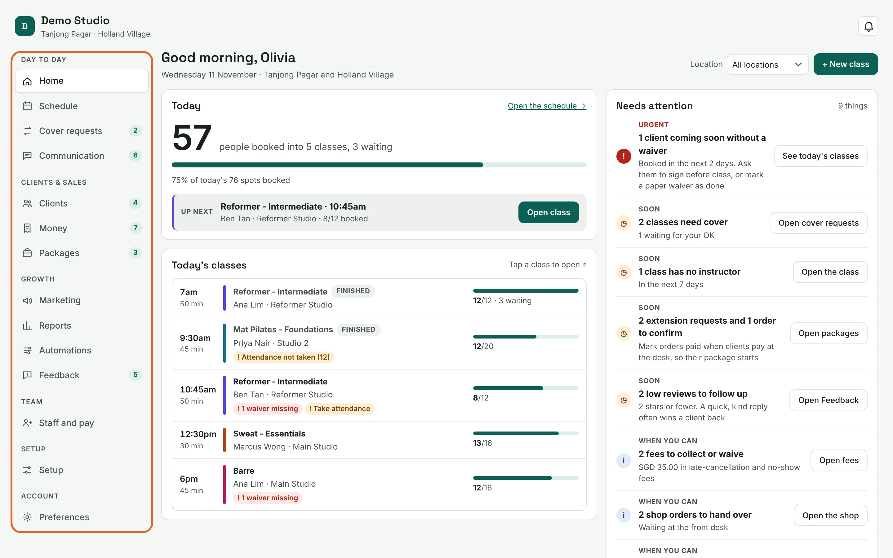
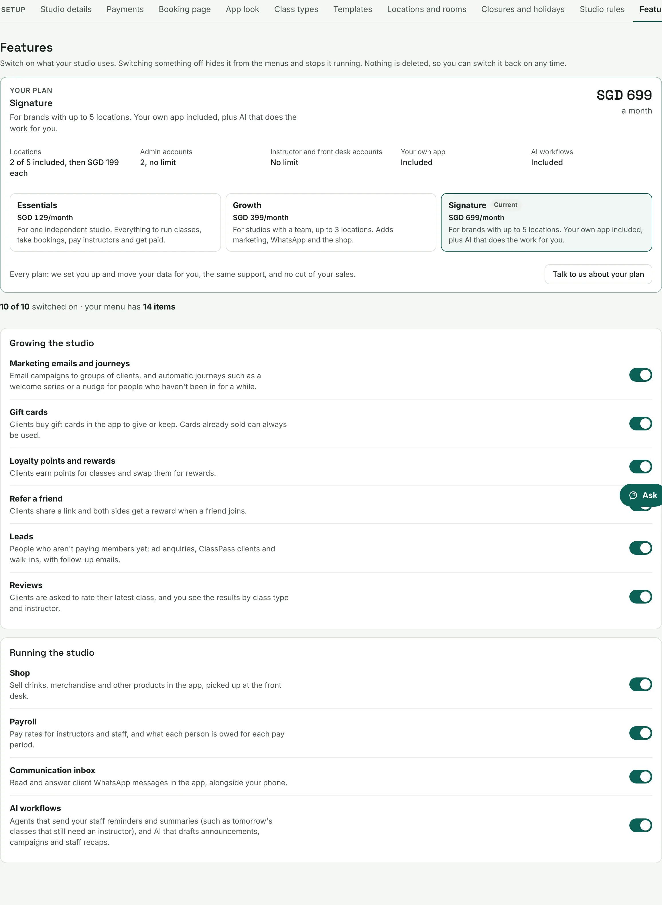

The menu on the left is grouped by what you're doing. Pages that belong together share one menu item, with tabs across the top. For example, **Money** has tabs for Sales, Fees and Shop.

Owners and admins see:

- **Day to day:** Home, Schedule, Cover requests, Communication.
- **Clients & sales:** Clients, Money, Packages.
- **Growth:** Marketing, Reports, Feedback.
- **Team:** Staff and pay, Agents.
- **Setup:** your classes, locations, rules, payments, booking page and features, as tabs.
- **Account:** Preferences.

Front of House see Home, Schedule, Communication, Pickups, Feedback and Preferences. Instructors see My day, My schedule, Cover requests, My reviews, My pay and Preferences.

The menu only shows the features your studio has switched on, so yours may be shorter. See [Your plan and features](#plan-and-features).

**Two buttons to know:**

- **Ask** (bottom right) opens the assistant. Ask it how to do something, or why something happened. See [Ask, the assistant](#ask).
- **The bell** (top) shows messages from your studio's team reminders.

---
id: who-can-do-what
title: Who can do what
category: Getting started
summary: What owners, admins, Front of House and instructors can each see and change.
keywords: roles, permissions, access, owner, admin, front of house, foh, instructor, staff access, can't see, not allowed, who can see, phone number, contact details, privacy
---
Everyone on your team has a role. The role decides what they see and what they can change.

| | Owner / Admin | Front of House | Instructor |
|---|---|---|---|
| See the schedule | Everything | Everything | Their own classes |
| Class lists | Every class | Every class | Their own classes |
| Book, cancel, move or refund for a client | Yes | No | No |
| Take attendance | Any class, and correct it after it locks | Any class, until it locks | Their own classes, from an hour before |
| Create, change or cancel classes | Yes | No | No |
| Client profiles, packages and fees | Yes | Contact details on class lists only | Contact details for their own classes |
| Sell and manage packages | Yes | No | No |
| Cover | Choose who covers, approve, assign | No | Ask for cover on their own classes |
| Messages | Yes | Yes | No |
| Reports, marketing, payroll, staff, studio rules | Yes | No | Their own pay, if the studio allows it |

Owners can do everything admins can. Only the owner can add or remove admins.

To change someone's role, go to **Staff and pay**, **Staff**, open the person and choose their access level.

---
id: first-sign-in
title: Your first sign-in: the welcome page
category: Getting started
summary: Tell us about your studio, choose how we move your data, and send it to our team.
keywords: onboarding, welcome, setup, getting started, new studio, move data, migration, switch, import, uen, gst
---
Until your studio opens, signing in shows a welcome page instead of the dashboard. Fill it in at your own pace: answers save as you go, and the list on the left ticks off each part.

1. **Your business:** studio name, registered business name, UEN, GST number (if you're registered), address, phone, website and Instagram. These go on your invoices and receipts. You can change them later under **Setup, Studio details**.
2. **Locations, rooms, what you teach, what you sell, your team:** we set these up for you from your answers. Your team is invited when your studio opens.
3. **Moving your data:** tick **We're a new studio** if there's nothing to move. Otherwise choose your old system and how we get your data:
   - add our team as a staff user (easiest);
   - share a temporary password (kept encrypted, and deleted after the move);
   - or upload the exports yourself. The page lists which reports to download.
4. Press **Send to our team**.

If anything changes afterwards, edit it and press **Send updates**. We're told exactly what changed.

**What happens next:** the welcome page shows where your move is up to. We check every row and move everything within a day, then double-check a sample against your old system. When that's done, your studio opens and the welcome page gives way to your dashboard.

Card details can't be moved in a file, so members add a card before their next billing date.

---
id: plan-and-features
title: Your plan and features
category: Getting started
summary: What Essentials, Growth and Signature include, and switching features on and off.
keywords: plan, pricing, essentials, growth, signature, upgrade, downgrade, features, switch off, turn on, hide, menu missing, add-on
---
Your studio is on one of three plans:

- **Essentials:** one studio. Everything to run classes, take bookings, pay instructors and get paid, plus reviews and gift cards. One admin account.
- **Growth:** studios with a team, up to 3 locations. Adds marketing (emails, journeys, banners, loyalty, refer a friend), the WhatsApp inbox and the shop. Your own app can be added.
- **Signature:** brands with several locations. Adds leads and ad tracking, team reminders and AI writing. Your own app is included, and there's no limit on admin accounts.

Every plan includes Ask, as many instructor and front desk accounts as you need, and the same setup, data move and support.

## Switching features on and off

**Setup, Features** lists the parts of the app your studio might not need: marketing, gift cards, loyalty, refer a friend, leads, reviews, the shop, payroll, the inbox and AI workflows. Switch on what you use. Menus, Home and the client app only show what's on.

- **Switching something off** hides it and stops it running. Nothing is deleted: switch it back on and everything is where you left it. If something is running (live journeys, orders waiting at the desk), you're told what will happen and asked first.
- **Switching back on** doesn't restart journeys or campaigns by itself, so nothing is sent late by surprise.

**To change plans,** choose **Talk to us about your plan** under Setup, Features. We set it up for you, and nothing is deleted if you move down.
