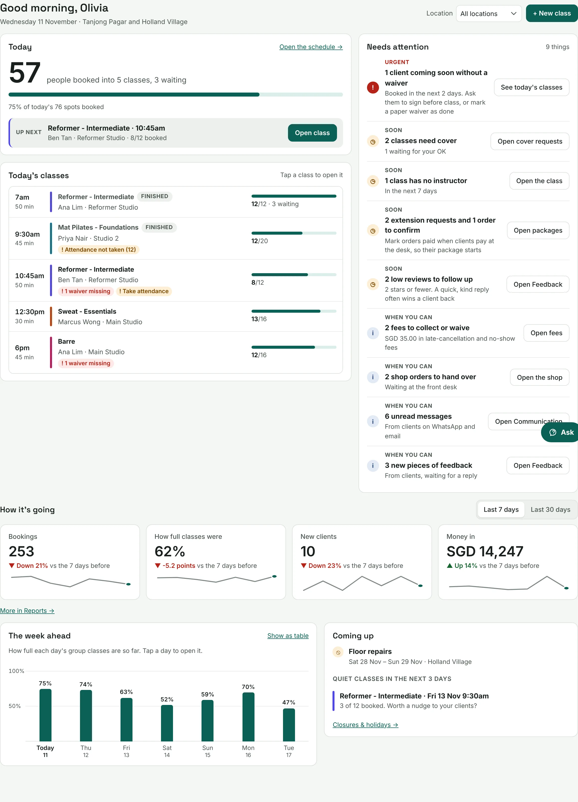
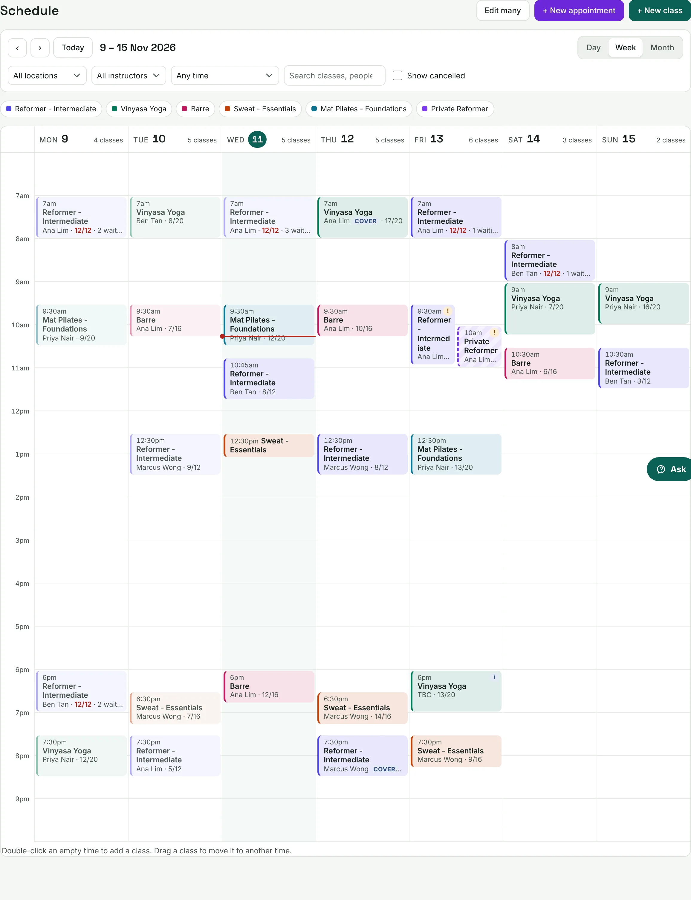
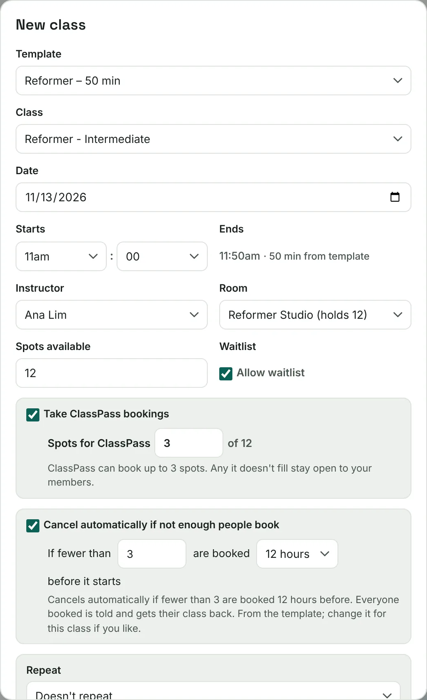
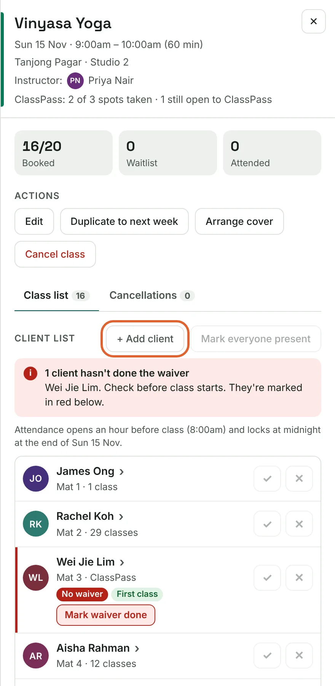
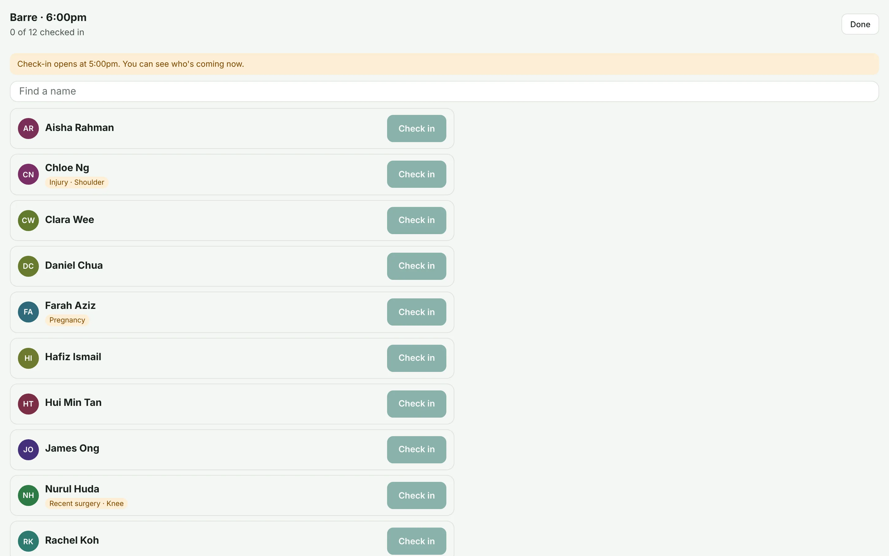
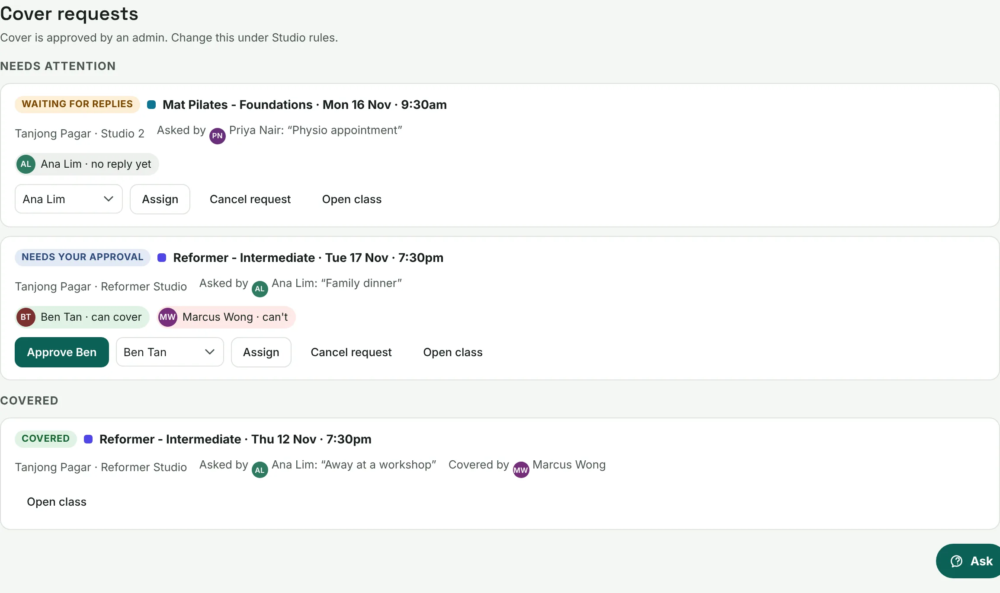
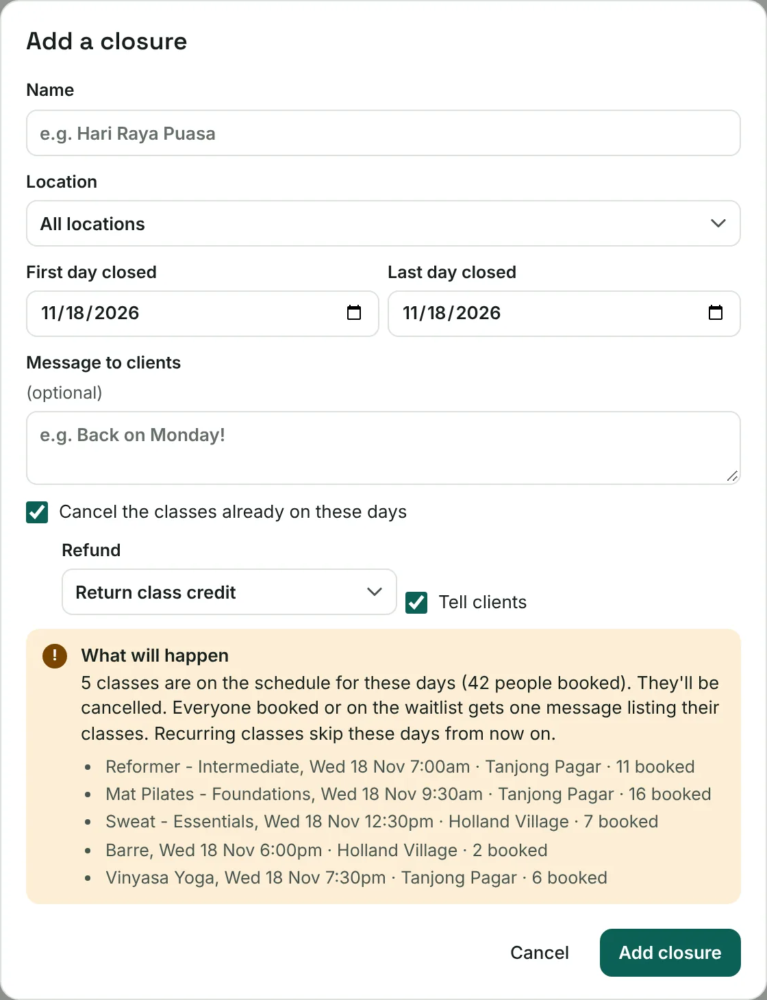

Home is the first page staff see. Instructors see it as **My day**, about their own classes.

- **Today:** how many people are booked into today's classes, and the class that's on now or up next. Tap **Open class** to go to it.
- **Today's classes:** every class today, with anything that needs doing: no instructor, a waiver missing, attendance to take.
- **Needs attention:** a short to-do list, most urgent first, marked **Urgent**, **Soon** or **When you can**. Each has a button that takes you where to sort it. When there's nothing, it says **All caught up**.
- **How it's going:** bookings, how full classes were, new clients and (owners and admins) money in, for the last 7 or 30 days, compared with the period before.
- **The week ahead:** how full each of the next 7 days is. Tap a day to open it on the schedule.
- **Coming up:** closures in the next 30 days, and quiet classes in the next 3 days that might be worth a nudge.

**Several locations?** Choose one at the top to see just that location. New clients and money in are always for the whole studio, and say so.

You only see what you can act on: Front of House never see fees or pay, and instructors see their own classes and cover requests.

---
id: add-class
title: Adding and changing classes
category: Day to day
summary: Add one class or a repeating one, move it, change it or cancel it.
keywords: new class, create class, add class, recurring, repeat, timetable, schedule, edit class, move class, drag, cancel class, appointment, private session, template, room
---
## Add a class

1. Go to **Schedule** and choose **+ New class**.
2. Pick a template to fill in most of the details, or fill them in yourself: class type, time, instructor, location, room and spots.
3. To make it repeat, choose **Repeats** and how often.
4. Save.

**Tips:**

- **Shortcut:** double-click an empty time on the calendar (on a computer). You're asked first, so a stray double-click doesn't start anything.
- **No room?** If a location is one open space, choose **No room**.
- **Versions of a class**, like "Reformer - Beginner" and "Reformer - Intermediate": the calendar always shows the full name, so you can tell them apart.
- **Appointments** (private sessions, not on the public timetable): choose **+ New appointment**. You can add the client straight away.

## Change a class

Tap the class, then **Edit**. For a repeating class, choose **this class**, **this and later** or **the whole series**.

**To move a class,** drag it to the new time or day. You're asked to confirm, and told about any clashes. Everyone booked or waiting is told about the new time. For a repeating class, only that one moves.

## Cancel a class

Tap it, then **Cancel class**. Everyone booked is told and gets their class back.

To see cancelled classes, tick **Show cancelled** next to the filters. They show crossed out. Cancelled classes can't be brought back: add a new class at the same time instead.

## Classes that cancel themselves

A class can cancel itself if fewer than a set number of people are booked a set number of hours before. Set this on a template or on the class (**Auto-cancel**).

---
id: edit-many
title: Changing or cancelling many classes at once
category: Day to day
summary: Pick classes on the calendar or by filters, then change or cancel them together.
keywords: bulk edit, edit many, change many, mass cancel, many classes, multiple classes, instructor change, holiday cancel
---
1. On **Schedule**, choose **Edit many**.
2. Choose the classes, either:
   - by picking them on the calendar; or
   - with filters: dates (up to a year ahead), class types, instructors, location, days of the week and start time.
3. Change anything you could set when creating a class (for example the instructor or the room), or cancel them all.

You see how many classes are affected before anything changes. Everyone booked into a changed or cancelled class is told.

**Closing for a holiday?** Use [Closures and holidays](#closures) instead: it cancels the classes, sends each person one message, and stops repeating classes landing on those days.

---
id: book-a-client
title: Booking a client into a class
category: Day to day
summary: Book someone in from the class, and what to do if it won't let you.
keywords: book client, add client to class, booking, enrol, reserve spot, sign up client, front desk booking
---
Owners and admins book clients in from the class itself.

1. Tap the class on the schedule.
2. Choose **+ Add client**, above the class list.
3. Find the client and confirm.

The booking uses the client's package that runs out soonest. If the class is full, add them to the waitlist instead.

If it won't let you, the message says why. The common reasons are in [I can't book a client into a class](#cant-book-client).

---
id: cancel-move
title: Cancelling and moving bookings
category: Day to day
summary: Cancel a client's booking, move them to another class, and how late cancellations work.
keywords: cancel booking, move booking, swap class, transfer, late cancel, late cancellation, give class back, credit back
---
**Cancel a booking:** tap the class, find the client in the class list, then **Cancel**.

- **Outside the late-cancellation window,** the class goes back to their package.
- **Inside it,** it counts as late: the class isn't given back, and a late fee may apply. Owners and admins can change both when cancelling.

**Move a booking:** open the client's booking and choose **Move**. It keeps the same package.

**Who cancelled?** Open the class and choose the **Cancellations** tab, next to **Class list**. It shows everyone whose booking was cancelled: when, how long before class, whether they did it or the studio did, whether they got the class back, and any late fee.

The late-cancellation window and fees are set under [Studio rules](#studio-rules).

---
id: check-in
title: Checking clients in
category: Day to day
summary: Instructors and the front desk: check people in, mark no-shows, and when attendance locks.
keywords: check in, attendance, roll call, mark present, no show, noshow, sign in clients, waiver at door, attendance lock
---
From an hour before class, the class's button says **Check in**. It opens check-in mode: everyone booked, in big rows sorted by first name.

1. Type a few letters of their name. The list narrows as you type.
2. Tap **Check in**. The search clears for the next person.
3. Tapped the wrong person? Tap again to undo.

- **No waiver?** You're asked first, and can mark a paper copy as done.
- **Once class has started,** each row also has **No-show**, and there's **Mark everyone not here as no-show**.

**When attendance locks:** attendance opens an hour before class and locks at midnight at the end of that day, in the location's time zone. After that, instructors and Front of House can't change it. Owners and admins still can, after a warning, because it adds or removes a no-show fee.

---
id: waitlists
title: Waitlists
category: Day to day
summary: How clients join a waitlist and get a spot when one opens.
keywords: waitlist, waiting list, full class, spot opens, automatic booking, ask first, hold spot
---
When a class is full, clients can join its waitlist. When a spot opens, the first person waiting gets it in one of two ways:

- **Book me in automatically:** they're booked straight in.
- **Ask me first:** the spot is held for them for a set time while they confirm. If they don't, it goes to the next person.

**Choosing how it works** (Setup, Studio rules, Waitlist):

- **Clients choose** lets each client pick when they join.
- **Always book in automatically** or **Always ask first** uses one way for everyone.

People already waiting keep the choice they made. Waitlists close when booking closes for the class.

---
id: cover
title: Cover requests
category: Day to day
summary: Instructors ask for cover; owners and admins choose who's asked, approve or assign.
keywords: cover, substitute, sub, replacement instructor, swap instructor, can't teach, sick, cover request
---
**Instructors:** open your class and choose **Ask for cover**. The request goes to the instructors who can teach that class, and the studio's admins are told.

**Owners and admins:** go to **Cover requests** to:

- choose who's asked;
- approve an instructor who offered;
- or assign someone directly.

Home's **Needs attention** shows classes still waiting for cover, most urgent first.

---
id: closures
title: Closures and holidays
category: Day to day
summary: Close the studio for a day or more, and what happens to the classes already booked.
keywords: closure, holiday, public holiday, closed, shut, chinese new year, hari raya, christmas, renovation, cancel days
---
Owners and admins add days the studio is closed under **Setup, Closures & holidays**.

1. Choose **+ Add closure**.
2. Give it a name clients will see (like "Hari Raya"), choose one location or all of them, the first and last days you're closed, and an optional message ("Back on Monday!").
3. Before you save, it shows how many classes are on those days and how many people are booked.
4. Confirm.

**What happens:**

- **Classes on those days are cancelled** in one go. Everyone booked or waiting gets **one** message listing all their cancelled classes, not one per class. You choose the refund; class credit back is the usual choice.
- **Want to keep the classes?** (For example, a special event on a holiday.) Untick **Cancel the classes already on these days**.
- **Repeating classes skip closed days** from then on. A course with a set number of classes still gets all of them: the missed class is added at the end.
- **Closed days are shaded and named** on the schedule, for staff and clients.

**Open on a public holiday?** There's nothing to do. Classes run as normal unless you add a closure.

**Removing a closure** brings back the repeating classes it left out. Classes it cancelled stay cancelled, because people were already told; add them again if you need to.
