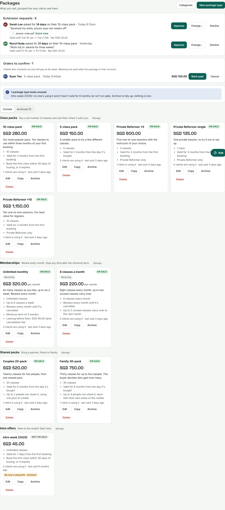

Set up what you sell under **Packages**: class packs or unlimited memberships, the price, how long they last, which classes they cover, sharing and weekly limits.

**Selling a package copies its terms,** so changing a package later never changes ones already sold.

**Each booking uses the package that runs out soonest,** so clients don't waste classes.

## When a pack starts

A pack starts on the day of the earliest class booked with it.

For example, a client books a class on the 19th, then one on the 16th. The pack simply starts on the 16th instead (and ends 3 days earlier). Nobody is told they have no package.

- Cancelling the earliest class moves the start to the next one.
- A pack sold with a start date can start earlier for an earlier class, but never later than that date.

## Members booking ahead

With **Studio rules, Members can book into their next period** on (it is by default), members can book classes after their membership renews. The class is held, and taken from the next period's classes when it renews.

Turn it off, and members book next period's classes once it has renewed.

---
id: extensions
title: Requests for more time
category: Clients & packages
summary: When a client asks to extend a package, with a doctor's note or other document.
keywords: extension, extend package, freeze, pause, more time, doctor's note, medical certificate, injury, travel
---
Requests for more time show at the top of **Packages**. Clients can attach something, like a doctor's note.

- **Tap the attachment** to open a quick view right there. PDFs show page by page; photos as they are.
- Zoom with **+** and **−**, go back with **Fit width**, and close with **✕** or Esc.
- **Download** saves a copy if you need one.

Approve or decline the request from the same place. Your studio's extension rules decide what clients can ask for, and some requests can be approved automatically.

---
id: clients-leads
title: Clients and leads
category: Clients & packages
summary: Everyone who books with you, and people who might.
keywords: clients, members, customers, leads, prospects, enquiries, walk-in, classpass, profile, history, tags
---
- **Clients:** everyone who books with you, with their history, tags, packages and fees. Owners and admins only.
- **Leads:** people who aren't paying members yet, like ad enquiries, walk-ins and ClassPass clients. When a ClassPass client buys one of your packages, they become a member.

Instructors and Front of House see contact details on class lists only.

---
id: reviews-feedback
title: Reviews and feedback
category: Clients & packages
summary: Star ratings after class, Google reviews, and what clients tell you.
keywords: reviews, ratings, stars, google reviews, feedback, complaints, suggestions, low review, reply to client
---
## Reviews

After a class they came to, clients are asked how it went: 1 to 5 stars and an optional comment. Only their latest class is asked about, so nobody is asked after every booking.

- **Skipping is fine;** they're asked again after their next class.
- **Clients can pause the questions** for 2, 4, 8 or 12 weeks.
- **Google reviews:** add your Google review link under **Studio rules, Reviews and celebrations**. After any review, the client is offered **Share on Google**. Everyone is offered it, whatever they gave: offering it only to happy clients is against Google's rules and can get your reviews removed.
- **The Reviews page** shows the average, each instructor's average, and every review. Instructors see their own as **My reviews**, with clients' first names and initials only.
- **Low reviews** (2 stars or fewer) tell owners and admins straight away, and wait under **Feedback, Needs attention** until someone follows them up.

## Feedback

Clients can tell you what they'd like under **Feedback** in their menu, choosing a topic (facilities, classes, instructors, the app, prices or something else).

- Owners, admins and Front of House see it under **Feedback**, with a tab for each topic.
- **Reply** from the item: the client gets it by email and in the app.
- Mark items **Replied** or **Sorted** as you go. If a client writes again about something Sorted, it goes back to New.
