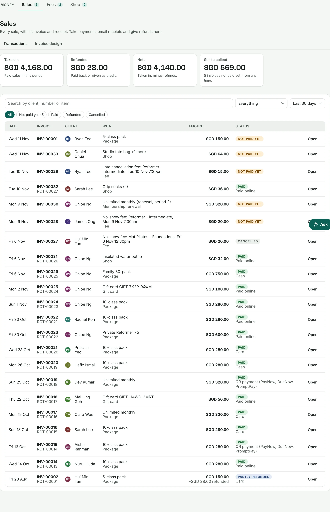
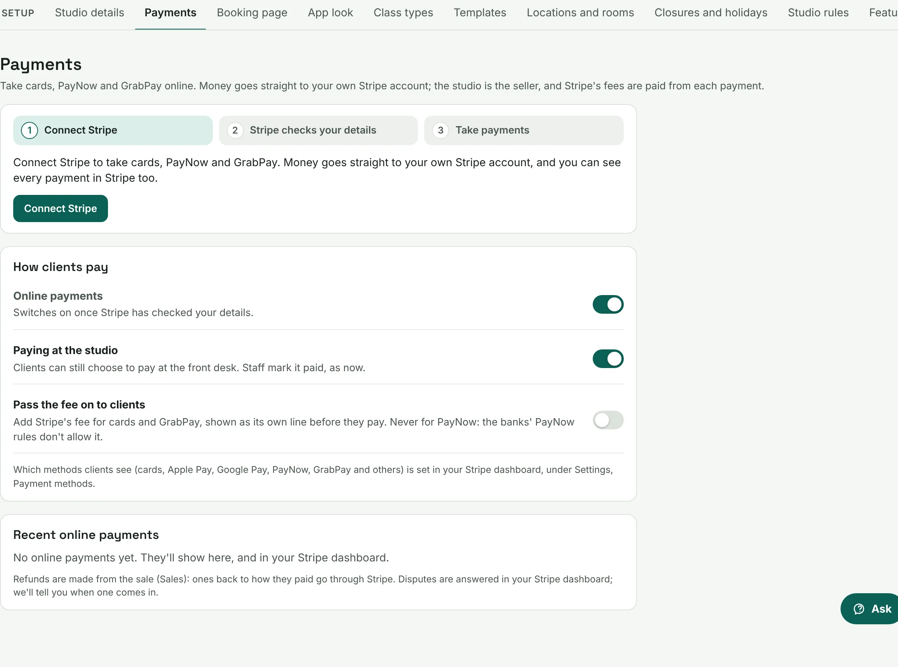

Every sale (packages, membership renewals, gift cards, shop orders and fees) gets an invoice, and a receipt once it's paid. Owners and admins find them under **Money, Sales**.

**Open a sale to:**

- view or print its invoice or receipt;
- **Email receipt**;
- **Mark as paid**, choosing how: card, cash, a QR payment such as PayNow, or bank transfer;
- **Refund** it (see [Refunds and fees](#refunds-fees)).

**Invoice design:** your business name, address, registration number (e.g. UEN), logo, colour, numbering, GST, how to pay, a note at the bottom, and whether receipts are emailed automatically. The preview updates as you type. Invoices already issued keep the details they were issued with.

Clients see and print their own receipts in the app, under **My packages, Receipts and invoices**.

---
id: refunds-fees
title: Refunds and fees
category: Money
summary: Give a class back, refund money, and collect or waive late-cancellation and no-show fees.
keywords: refund, money back, give class back, late fee, no-show fee, waive fee, collect fee, credit, studio credit, cancellation fee
---
Refunds are done by owners and admins only.

**Give a class back:** use **Refund** on the booking in the class list.

**Refund money** (a package, gift card, shop order or fee):

1. Go to **Money, Sales** and open the sale.
2. Choose **Refund**.
3. Choose the amount, the reason, and whether it goes back the way they paid or as studio credit.
4. Optionally cancel what was bought (for example the package) at the same time.

Card refunds made through Skedoo go back through Stripe straight away. PayNow refunds can take a few days.

## Fees

Late-cancellation and no-show fees are listed under **Money, Fees**, where admins collect or waive them.

- **A late-cancellation fee** is added when someone cancels inside the late-cancellation window. It's final straight away.
- **A no-show fee** is added when someone is marked as a no-show. It follows attendance until attendance locks at midnight at the end of the class's day. If attendance is corrected before then, the fee is removed. Until then the Fees page shows it as **Final after midnight**.

---
id: online-payments
title: Taking payments online
category: Money
summary: Connect Stripe so clients can pay by card, Apple Pay, Google Pay, PayNow and GrabPay.
keywords: stripe, online payment, card, credit card, apple pay, google pay, paynow, grabpay, connect stripe, payout, surcharge, card fee, dispute, chargeback
---
Clients can pay online once you connect Stripe under **Setup, Payments**. Money goes straight to your own Stripe account: you're the seller, Stripe's fees come out of each payment, and you can see everything in your Stripe dashboard too.

**Connecting** (owners only, as the account is in your business's name):

1. Choose **Connect Stripe**.
2. Stripe asks for your business details (registered name, UEN, address), your own details and the bank account for payouts.
3. Stripe checks them, usually within minutes. We'll tell you when you can take payments.

**Choices:**

- Switch online payments on or off, and choose whether clients can still pay at the studio.
- **Pass the card fee on:** optionally add Stripe's fee for cards and GrabPay as its own line. It's never added for PayNow, whose rules don't allow it.
- Which payment methods clients see is set in your Stripe dashboard (Settings, Payment methods).

**Memberships** are paid by card when bought, and Stripe keeps the card for renewals (you never see the full number). Clients replace it under **Payment method**.

**Disputes:** if a client asks their bank to reverse a payment, we'll tell you. Answer it in your Stripe dashboard before the deadline, with what shows they booked or came.

---
id: failed-renewals
title: When a membership payment fails
category: Money
summary: What happens when a renewal doesn't go through, and how the client fixes it.
keywords: failed payment, declined, card declined, renewal failed, membership on hold, expired card, retry, update card, overdue
---
When a membership's renewal payment doesn't go through, the membership is **on hold**: the client can't book with it until it's paid.

1. The client is asked to update their card, and can pay straight away in the app.
2. The card is tried again 3 days and 7 days later.
3. Owners and admins can also take the payment at the desk.

**If it still isn't paid after 7 days,** the membership ends. Upcoming bookings made with it are cancelled, and any early termination fee applies (if it's within the minimum term). To carry on, the client buys a new membership.

---
id: shop
title: The shop and pickups
category: Money
summary: Sell merch and gift cards in the app; clients collect at the front desk.
keywords: shop, merch, merchandise, grip socks, products, store, gift card, pickup, collect, front desk, stock, sizes
---
Owners and admins add items under **Money, Shop**: name, price, photo, sizes or colours, and how many you have. Gift card settings are here too.

- **Clients see Shop** in their app once something's on sale (or gift cards are on). It disappears when the shop is empty.
- **They order in the app and collect at the front desk,** paying online when they order (if you take payments online), when they collect, or with studio credit.
- **Front of House hand orders over** under **Pickups**, taking payment first if it isn't paid.
