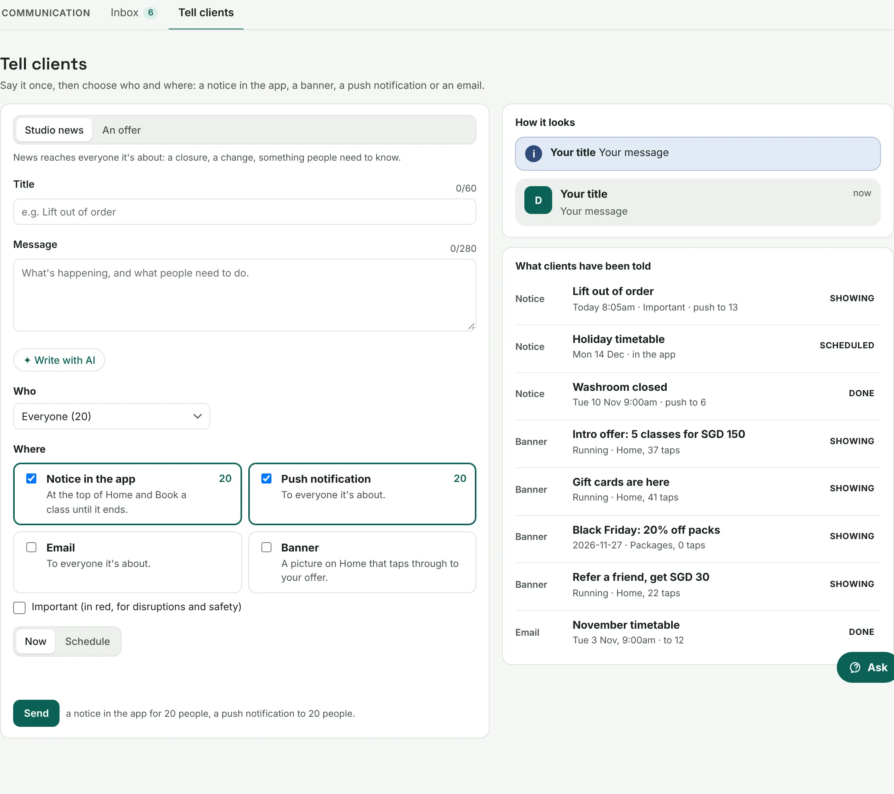
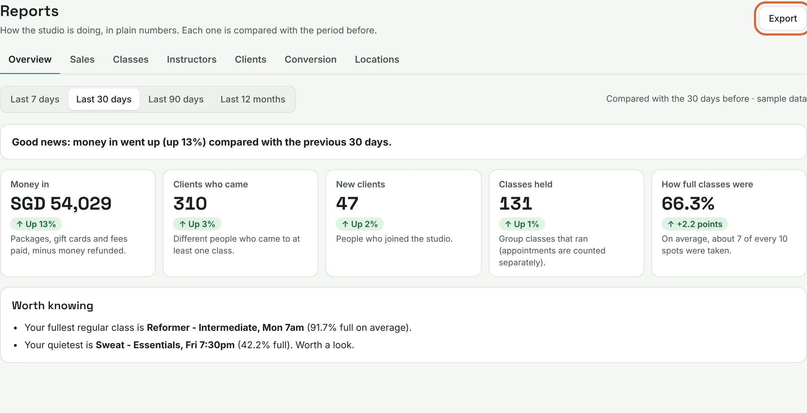
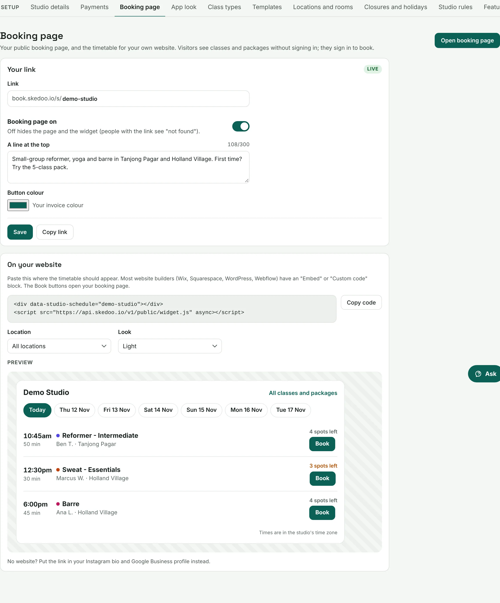
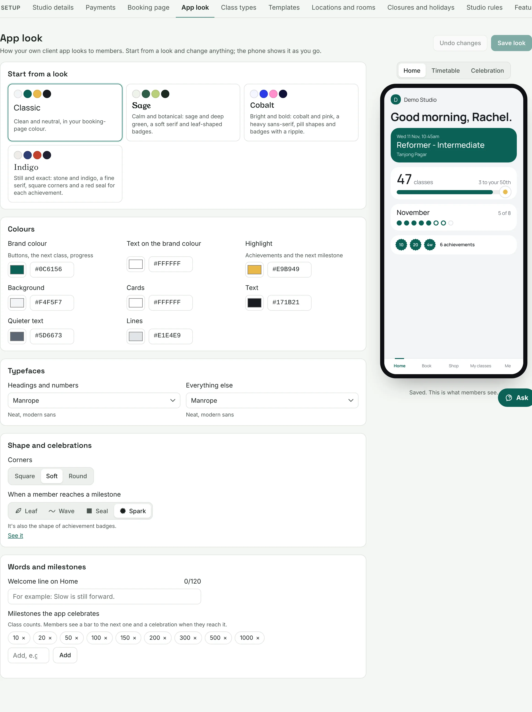

**Communication, Tell clients** is the one place to tell clients anything. Write a title and message once, then choose:

1. **What it is:**
   - **Studio news** (a closure, a change, something people need to know) reaches everyone it's about.
   - **An offer** only reaches people who agreed to marketing.
2. **Who:** everyone, people who come to one location, people booked at a location in the next few days, or a segment.
3. **Where:** a notice in the app (tick **Important** for disruptions), a banner, a push notification and/or an email. Each shows how many people it reaches.
4. **When:** now, or scheduled.

You see how it looks before sending, and you're asked once, with the numbers. Front of House can send studio news; offers, banners and emails are for owners and admins.

---
id: automations
title: Automations
category: Growth
summary: Everything that runs by itself: journeys for clients and reminders for your team.
keywords: automation, journey, drip, welcome email, win back, follow up, team reminder, agent, workflow, notification to staff
---
**Automations** lists everything that runs by itself:

- **For clients (Growth and Signature):** journeys, such as welcoming new members, winning back people who stopped coming, and following up intro offers.
- **For your team (Signature):** reminders that tell staff (never clients) about things, in the bell and as push notifications. For example: classes needing cover, quiet classes the night before, tomorrow's teaching line-up, classes without an instructor.

To set up a team reminder, pick a ready-made one, name it, and adjust when it runs, what it checks and who it tells. **Preview** shows exactly what it would send right now.

Team reminders never see client names, contact details, health notes, payments or pay, and never change anything.

---
id: reports
title: Reports
category: Growth
summary: How the studio is doing, compared with the period before, and exporting the numbers.
keywords: reports, analytics, stats, numbers, revenue, attendance rate, fill rate, export, csv, pdf, spreadsheet, accountant, locations compared
---
**Reports** has tabs: Overview, Sales, Classes, Clients, Conversion and Instructors. Each number is compared with the period before.

- **Zoom in** (on the Classes tab) narrows everything to a class type, location, instructor, days of the week or time of day.
- **Export** (top right) gives you either **Raw data (CSV)**, every row behind the numbers for a spreadsheet or your accountant, or a **Visual report**, a one-page summary to print or save as a PDF. Both follow the tab, period and zoom you're looking at. Client exports never include contact details.
- **Locations** (Signature) shows every location side by side.

---
id: booking-page
title: Your booking page and website widget
category: Growth
summary: A public page with your timetable and packages, and a timetable for your own website.
keywords: booking page, website, widget, embed, link, instagram bio, google business, public timetable, wix, squarespace, wordpress
---
Under **Setup, Booking page**:

- **Your link,** like book.skedoo.io/s/your-studio. Anyone can see your timetable and packages there without signing in; they sign in to book or buy. Put it in your Instagram bio and Google Business profile. Choose it carefully: changing it later breaks the old link.
- **On or off,** a line at the top (what you offer, who it's for), and the colour of the buttons.
- **On your website:** copy the code into your website's "Embed" or "Custom code" block (Wix, Squarespace, WordPress and Webflow all have one). It shows your timetable with spots left and Book buttons. You can show one location only, and choose light, dark or the visitor's own setting.

Visitors see instructors' first names and initials, spots left and when booking opens, but never who else is booked. Private sessions aren't shown.

---
id: app-look
title: Your app's look
category: Growth
summary: Colours, typefaces, celebrations and milestones for your own branded client app.
keywords: branded app, app look, theme, colours, colors, brand, logo, font, typeface, celebration, milestone, white label, own app
---
With your own app (Signature, or Growth with the app add-on), go to **Setup, App look**.

1. Start from one of four looks: Classic, Sage, Cobalt or Indigo.
2. Change the colours, the typefaces, the corners and how celebrations look.
3. Add a welcome line for members' Home, and the class milestones the app celebrates.
4. **Save look** when you're happy.

The phone beside it shows the result as you go. If text on your brand colour would be hard to read, it says so and offers a fix.

---
id: inbox
title: The inbox: WhatsApp and email
category: Growth
summary: Read and reply to clients' WhatsApp messages and emails in one place.
keywords: inbox, whatsapp, email, gmail, outlook, messages, reply to client, communication, chat, dm
---
**Communication, Inbox** brings WhatsApp messages and emails from clients into one place. Filter by **All**, **WhatsApp** or **Email**.

- **Email:** an owner or admin connects the studio's Gmail (or Google Workspace) or Outlook (or Microsoft 365) account under **Communication, Settings**, by signing in with Google or Microsoft. Replies go from that address, in the same thread.
- **WhatsApp** works alongside the WhatsApp Business app on your phone. Before using it, choose how messages are paid for under Communication, Settings. Replies within 24 hours of a client's message are free; Meta charges for some other messages.
