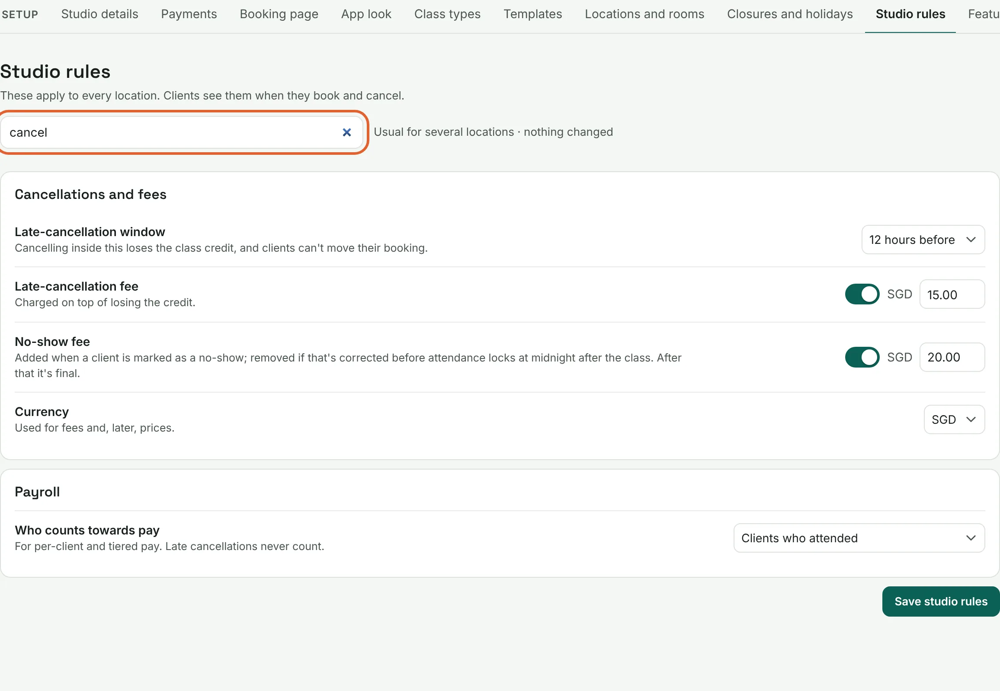

**Ask** (bottom right) answers questions about using Skedoo and about your studio. For example, "why can't I book Sarah into the 7am class?"

- It only sees what your role can see.
- It can offer to book a client in, add them to a waitlist, or cancel a booking that's free to cancel. It does it only when you press **Confirm**.
- It can't do anything involving money, change settings, staff or the schedule, delete anything, or share client contact details or health notes. For those, it tells you who can and where.

**Ask or the help centre?** Ask is quickest for a specific question about your studio right now. This help centre explains how everything works, for reading at your own pace.

**AI credits:** each plan includes a number a month, shared by Ask (1 per answer), Write with AI and AI recaps. Owners and admins are told at 80% and when they're used up, and can buy a top-up.

Owners and admins can switch Ask off, choose which roles can use it, and stop it doing things for people, under its settings.

---
id: write-with-ai
title: Write with AI
category: AI
summary: Draft or tidy up text in your studio's voice, next to the text boxes that need it.
keywords: write with ai, draft, copywriting, ai writing, generate text, rewrite, email draft, marketing copy
---
Next to some text boxes (Tell clients, inbox replies, package descriptions, journey messages), **Write with AI** drafts the text from a sentence or two, or tidies up what you've written.

- It writes in your studio's voice and only uses facts you give it. Anything missing becomes a [placeholder] for you to fill in.
- It never sends anything itself.
- 1 AI credit per draft. On **Marketing, Campaigns**, **Draft with AI** writes a whole email (3 credits). Part of AI workflows, on Signature.

---
id: celebrations
title: Celebrations for your team
category: AI
summary: Fortnightly recaps and milestones for owners, admins and instructors.
keywords: celebration, recap, milestone, achievement, motivation, pop-up, popup, classes taught
---
Owners, admins and instructors get a pop-up on **Home** when there's something to celebrate:

- **Every two weeks, a recap:** classes taught, people who came (and how many came back), how full classes were, and reviews.
- **Milestones:** 50, 100, 250, 500 and more classes taught; for the studio, classes held and total visits.
- **With AI recaps on** (Studio rules), the recap includes a short summary of what clients said and two self-care tips. It sees numbers and review text only, never names or contact details. 1 AI credit per recap.

Anyone can turn the pop-ups off for themselves with **Don't show these**, and back on under **Preferences**. Owners and admins can turn them off for everyone under Studio rules.

---
id: studio-rules
title: Studio rules
category: Setup
summary: Booking and cancellation windows, fees, limits, waivers, waitlists and more, with search.
keywords: studio rules, policies, settings, booking window, cancellation window, late fee, no-show fee, weekly limit, waiver, spot booking, rules, policy
---
**Setup, Studio rules** holds how your studio works: the booking window, the late-cancellation window and fees, no-show fees, weekly limits, whether clients need a package, waivers, spot booking, waitlists and how cover works.

- **Search:** type a word like "cancel", "waitlist" or "pay" in the box at the top to see just those settings.
- **Changed:** settings that differ from the usual for your kind of studio are marked **Changed**, with a link to put the usual value back.

---
id: class-types
title: Class types and templates
category: Setup
summary: The kinds of classes and appointments you run, and saved class details.
keywords: class types, appointments, private sessions, templates, class template, categories of class
---
**Setup, Class types** lists your group **Classes** and private **Appointments** separately, each with its own **+ New** button. Appointments show which packages cover them.

**Setup, Templates** holds saved class details, to fill in new classes quickly. Deleting a template doesn't change classes already made from it; it just can't be used for new ones.
